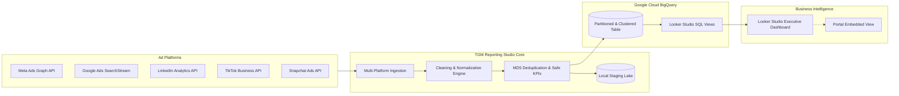

# TGM Reporting Studio

> **Automated Multi-Platform Advertising Pipeline & Agency Reporting Portal for Google BigQuery and Looker Studio.**

TGM Reporting Studio ingests advertising performance data from **Meta (Facebook & Instagram)**, **Google Ads**, **LinkedIn Ads**, **TikTok Ads**, and **Snapchat Ads**, automatically cleans and normalizes the data into a unified cross-channel schema, streams it into **Google BigQuery**, and powers interactive **Looker Studio** executive dashboards.

---

## Architecture Overview



---

## Key Features

1. **Direct Multi-Platform Connectors**:
   - **Meta Ads**: Graph API `v19.0` (Insights with conversions, purchases value, LPVs, 3s video plays, ThruPlays, adds to cart, checkouts initiated).
   - **Google Ads**: REST API `v16` (`searchStream` with GAQL queries for Search, Shopping, PMax, YouTube).
   - **LinkedIn Ads**: Marketing REST API (`adAnalyticsV2` with daily pivot breakdown).
   - **TikTok Ads**: TikTok Business API (`report/integrated/get` with auction ad insights).
   - **Snapchat Ads**: Snapchat Ads API (`stats` endpoint with swipe metrics, video plays, and pixel conversions).
   - **Sandbox Mock Generator**: Generates realistic multi-channel data matching the exact spreadsheet products, categories, funnels, sales, and hooks.

2. **Full Google Sheets Specification Compliance**:
   - **Time Frames**: `Day*`, `Week`, `Month`.
   - **11 Raw Input Metrics**: Amount spent, Purchases conversion value, Purchases, Landing page views (LPV), Reach, Impressions, Link clicks, 3-second video plays, 15-second ThruPlays, Adds to cart (ATC), Checkouts initiated (IC).
   - **17 Formulated Calculated Metrics**: Purchase ROAS, Cost per purchase (CPA), Avg purchase conversion value (AOV), Purchases rate per LPV, Cost per LPV, LPV rate per link clicks, Frequency, CPM, CPC, CTR, 3s video play rate (Thumbstop), Cost per 3s video play, Cost per 15s ThruPlay, Cost per ATC, Add to cart %, Cost per IC, Checkout initiated %.
   - **8 Weekly Nomenclature Breakdown Tables**: Auto-parsed taxonomy dimensions for `CATEGORY/COLLECTION`, `PRODUCTNAME`, `FUNNEL`, `(SALENAME+OFFER)`, `AUDIENCETYPE`, `CONCEPT/ANGLE-HOOK`, `FORMAT`, and `LANDINGPAGE`.

3. **Multi-Client Isolation & Role-Based Access Control (RBAC)**:
   - Dedicated Google Sheet URL and GID configuration per client.
   - Separate data streams and client-isolated databases without cross-contamination.
   - Role-based permissions (`Admin`, `Manager`, `Viewer`) with secure authentication.
   - Instant client portal links providing real-time, view-only dashboards without login credentials.

4. **Google BigQuery Warehouse**:
   - Native **DAY partitioning** on `date` column.
   - Native **clustering** on `platform`, `client_id`, `campaign_name`.
   - Automated deployment of analytical views:
     - `v_looker_studio_daily_overview`: Flat daily cross-channel view with all 11 raw metrics and 17 safe-calculated ratios.
     - `v_looker_studio_weekly_nomenclature`: Weekly rollup across the 8 taxonomy dimensions.
     - `v_looker_studio_creative_performance`: Creative video & thumbstop analysis view.

5. **Looker Studio Reporting**:
   - 1-click BigQuery connection to pre-aggregated views.
   - Comprehensive calculated fields reference dictionary (`looker_studio/calculated_fields.md`) with exact aggregated formulas.
   - In-app interactive portal with live scorecards, weekly taxonomy breakdown tables, and embedded Looker Studio dashboard viewer.

---

## Quick Start

### 1. Start the Agency Portal
```bash
python3 run.py
```
Or with npm:
```bash
npm start
```
Open your browser to: **`http://localhost:8000`**

### 2. Run Your First Sync
1. Open the portal at `http://localhost:8000`.
2. Click **Sync Data Now** in the top navigation.
3. Select your date range and platforms.
4. Click **Start Pipeline Execution**.
5. The dashboard instantly updates with cross-channel KPIs, spend vs. revenue charts, and platform performance breakdowns!

### 3. Connect to BigQuery & Looker Studio
1. Navigate to the **BigQuery** tab in the portal.
2. Enter your GCP Project ID and Service Account JSON key.
3. Click **Deploy Tables & Views**.
4. Open [Looker Studio](https://lookerstudio.google.com/), select **BigQuery &rarr; My Projects &rarr; tgm_reporting &rarr; v_looker_studio_daily_overview**.
5. Copy your Looker Studio report embed URL and paste it into the **Looker Studio** tab in the portal.

---

## Directory Structure

```text
TGM-Reporting-Tool/
├── package.json                 # Project configuration & npm scripts
├── requirements.txt             # Python dependencies
├── run.py                       # Application launcher
├── backend/
│   ├── app/
│   │   ├── main.py              # FastAPI REST API & Static Server
│   │   ├── config.py            # App configuration & paths
│   │   ├── database.py          # SQLite storage for clients, records & logs
│   │   ├── models/              # Pydantic models for Schema, Clients, RBAC
│   │   ├── connectors/          # Meta, Google, LinkedIn, TikTok, Snapchat & Mock
│   │   ├── pipeline/            # Cleaning, Normalization, Validation, BigQuery
│   │   └── services/            # Sync Orchestration & Looker Service
├── frontend/
│   ├── index.html               # Modern Agency Portal SPA
│   ├── portal.html              # Client-Facing Live Portal
│   ├── css/style.css            # Premium Design System (Dark mode, Glassmorphism)
│   └── js/
│       ├── app.js               # Application logic & API handlers
│       ├── portal.js            # Client-facing portal logic
│       ├── charts.js            # Interactive Chart.js visualizations
│       └── chart.min.js         # Local fallback bundle
└── looker_studio/
    ├── README.md                # Step-by-step Looker Studio guide
    ├── bigquery_views.sql       # Production SQL views DDL
    └── calculated_fields.md     # Looker Studio formula reference
```
